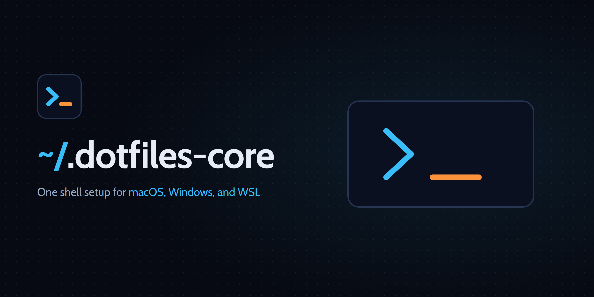

[](https://dotfiles.marcopontili.com)

# dotfiles-core

Cross-platform dotfiles for macOS, Windows, Git Bash, and WSL. This is the core: the part every machine shares. Identity, employer, and machine-specific configuration stays local.

One shared `sh` layer, platform-specific shell entrypoints, one manifest, and symlinks into your home directory. Configuration stays in one repository instead of drifting across machines.

Overview and quick start: [dotfiles.marcopontili.com](https://dotfiles.marcopontili.com)

## Why

I use a Mac and a Windows machine that also runs WSL. Without a shared source of truth, shell and tool configuration gradually diverges.

## What's included

- Shell configuration, functions, and aliases
- [Starship](https://starship.rs) prompt
- Git configuration and global ignores
- Claude Code user configuration
- Local override points for machine-specific and private configuration

Not included: Git identity, employer and client configuration, package lists, macOS system settings, and editor and terminal settings.

## Supported environments

| Platform | Shell      | Entry point                                |
| -------- | ---------- | ------------------------------------------ |
| macOS    | zsh        | `macos/zshrc`                              |
| Windows  | Git Bash   | `windows/bashrc` + `windows/bash_profile`  |
| Windows  | PowerShell | `windows/Microsoft.PowerShell_profile.ps1` |
| WSL      | bash       | `wsl/bashrc`                               |

The POSIX shells share the same `sh` layer. PowerShell has its own entrypoint because it cannot source POSIX shell configuration.

## Requirements

`git` and one of the shells above. Starship is optional; without it, the shell keeps its normal prompt.

Windows symlinks need Developer Mode or an elevated shell. The installers say so when the permission is missing.

## Install

Clone the repository anywhere, read the dry run, then apply it.

macOS, WSL, and Git Bash:

```sh
git clone https://github.com/marcop135/dotfiles-core.git ~/code/dotfiles-core
cd ~/code/dotfiles-core
./scripts/install.sh          # dry run: print the plan
./scripts/install.sh --apply  # create the links
```

Windows PowerShell:

```powershell
git clone https://github.com/marcop135/dotfiles-core.git ~/code/dotfiles-core
cd ~/code/dotfiles-core
.\scripts\install.ps1         # dry run: print the plan
.\scripts\install.ps1 -Apply  # create the links
```

Install one module with `--only shell`, or skip one with `--skip prompt`. PowerShell takes `-Only` and `-Skip`.

## Installation manifest

`scripts/modules.conf` is the single manifest used by both installers and `check.sh`.

| Module   | Source                                     | Installed as                   | Environment          |
| -------- | ------------------------------------------ | ------------------------------ | -------------------- |
| `shell`  | `macos/zshrc`                              | `~/.zshrc`                     | macOS                |
| `shell`  | `windows/bashrc`                           | `~/.bashrc`                    | Git Bash             |
| `shell`  | `windows/bash_profile`                     | `~/.bash_profile`              | Git Bash             |
| `shell`  | `wsl/bashrc`                               | `~/.bashrc`                    | WSL                  |
| `shell`  | `windows/Microsoft.PowerShell_profile.ps1` | `$PROFILE.CurrentUserAllHosts` | PowerShell           |
| `prompt` | `shared/starship.toml`                     | `~/.config/starship.toml`      | macOS, WSL           |
| `prompt` | `windows/starship.toml`                    | `~/.config/starship.toml`      | Git Bash, PowerShell |
| `git`    | `shared/git/gitconfig`                     | `~/.gitconfig`                 | all                  |
| `git`    | `shared/git/ignore`                        | `~/.config/git/ignore`         | all                  |
| `claude` | `shared/claude/CLAUDE.md`                  | `~/.claude/CLAUDE.md`          | all                  |
| `claude` | `shared/claude/settings.json`              | `~/.claude/settings.json`      | all                  |

Files are linked, not copied. The repository remains the source of truth after installation.

## Shell

The shared shell layer lives in `shared/shell/` and is loaded by the POSIX shells.

### Functions

| Command          | Purpose                                               |
| ---------------- | ----------------------------------------------------- |
| `mkcd <dir>`     | Create a directory and enter it                       |
| `up 3`           | Move up three directory levels                        |
| `groot`          | Jump to the repository root                           |
| `path`           | Print `PATH`, one entry per line                      |
| `port 3000`      | Find the process using a port                         |
| `serve [port]`   | Serve the current directory over HTTP                 |
| `extract <file>` | Extract common archive formats                        |
| `ff <pattern>`   | Recursive search, skipping `.git`                     |
| `sizes [dir]`    | Show entries ordered by size                          |
| `update_all`     | Update npm, pipx, and the platform's package managers |

### Aliases

| Alias                 | Purpose                                          |
| --------------------- | ------------------------------------------------ |
| `g`, `gs`, `gd`, `gl` | `git`, status, diff, and log                     |
| `..`, `...`, `....`   | Move up one, two, or three directories           |
| `-`, `d`              | Return to the previous directory, list the stack |
| `ll`, `la`, `l`       | Long, all-files, and normal `ls`                 |
| `cp`, `mv`            | Interactive overwrite protection                 |
| `df`, `du`            | Human-readable sizes                             |
| `myip`                | Print the public IP address                      |
| `reload`              | Restart the shell in place                       |

## Prompt

Starship is configured to stay quiet outside projects. Language versions appear only in projects that use them, and Git information only inside repositories.

`COLORFGBG`, set at shell startup from the OS appearance, keeps `bat`, `delta`, and `less` aligned with the terminal theme. Refresh it without restarting the shell with `theme_refresh`, or `Update-Theme` in PowerShell.

## Git

`shared/git/gitconfig` holds portable settings and `shared/git/ignore` the global ignores. No Git identity is stored in this repository; put yours in `~/.gitconfig.local`.

## Claude Code

`CLAUDE.md` and `settings.json` are linked into `~/.claude/` as user-level defaults. A project's own `CLAUDE.md` or `AGENTS.md` is read afterward and takes precedence.

<details>
<summary>What the user-level settings do</summary>

`settings.json` deliberately contains no allow list: command grants stay machine-specific rather than copied from a public repository. It also:

- disables telemetry, error reporting, and the auto-updater
- follows the terminal theme and prevents automatic commit trailers
- enables `acceptEdits`, while commands still require approval
- disables bypass-permissions mode and auto mode
- denies secret `.env` spellings (not `.env.example`), keys, and `secrets/`
- denies `~/.ssh`, `~/.claude.json`, and the Claude credentials file
- denies `rm -rf` and recursive `Remove-Item`
- denies raw sockets, outbound tunnels, and `gh api` ref-write routes
- denies history rewrites and force-push at any flag position
- denies pushes to `main`, `master`, and `develop`

The deny rules are a safety floor, not a security sandbox.

MCP servers, hooks, agents, skills, and a statusline are intentionally absent. MCP configuration lives in `~/.claude.json`, which Claude Code manages itself, and the rest would add runtime dependencies.

</details>

## Local overrides

Tracked configuration sources local overrides last, so local values win without modifying the repository.

| Tracked configuration     | Local override                                    |
| ------------------------- | ------------------------------------------------- |
| `~/.zshrc`, `~/.bashrc`   | `~/.shell.local`, plus shell-specific local files |
| PowerShell profile        | `profile.local.ps1` next to it                    |
| `~/.gitconfig`            | `~/.gitconfig.local`                              |
| `~/.config/starship.toml` | none                                              |
| `~/.config/git/ignore`    | none                                              |
| `~/.claude/settings.json` | none, use project `.claude/settings.local.json`   |

Create the shared shell override from the example:

```sh
cp shared/shell/local.sh.example ~/.shell.local
```

Anything private, machine-specific, or employer-specific belongs in these local files.

## Update

Pull the repository and re-run the installer. Existing links are left alone and new configuration is linked.

```sh
git pull
./scripts/install.sh --apply      # PowerShell: .\scripts\install.ps1 -Apply
```

## Uninstall

`--status` shows what is linked. `--unlink` is a dry run until `--apply`, and removes only symlinks that point into this repository. `--restore` moves the newest backup back.

```sh
./scripts/install.sh --status
./scripts/install.sh --unlink --restore --apply
```

PowerShell takes `-Status`, `-Unlink`, `-Restore`, and `-Apply`. Existing files are never deleted: before a link replaces one, the installer renames it to `<target>.bak.<timestamp>`.

## Tooling

| Command                          | Purpose                                                                  |
| -------------------------------- | ------------------------------------------------------------------------ |
| `./scripts/install.sh`           | Install, inspect, or unlink configuration on POSIX shells                |
| `.\scripts\install.ps1`          | Install, inspect, or unlink configuration from PowerShell                |
| `./scripts/doctor.sh`            | Diagnose common configuration problems                                   |
| `.\scripts\doctor.ps1`           | Diagnose common Windows configuration problems                           |
| `bash ./scripts/check.sh`        | Validate the manifest, file tree, Markdown, shell syntax, and ShellCheck |
| `bash ./scripts/check-site.sh`   | Validate `site/` structure and internal links                            |
| `bash ./scripts/test-install.sh` | Test apply, unlink, and restore against a throwaway home directory       |
| `.\scripts\test-install.ps1`     | The same test for the PowerShell installer, `prompt` module only         |
| `./macos/bootstrap.sh`           | Bootstrap Homebrew, CLI tools, nvm, and Starship on a fresh Mac          |
| `./wsl/bootstrap.sh`             | Bootstrap packages, nvm, and Starship on a fresh WSL distribution        |

CI runs the installation lifecycle on macOS, Ubuntu, and Windows. Ubuntu stands in for WSL because GitHub Actions has no WSL runner.

## Contributing

A change has to keep working on every supported platform. Before opening a pull request, run the gate:

```sh
bash ./scripts/check.sh         # every change
bash ./scripts/test-install.sh  # every change
bash ./scripts/check-site.sh    # a change under site/
```

A change to the PowerShell installer also runs `.\scripts\test-install.ps1`.

| Document                           | Covers                                                 |
| ---------------------------------- | ------------------------------------------------------ |
| [CONTRIBUTING.md](CONTRIBUTING.md) | Constraints, adding a link, branches and pull requests |
| [AGENTS.md](AGENTS.md)             | The full working contract behind those rules           |
| [SECURITY.md](SECURITY.md)         | What the scripts do to a machine, reporting a leak     |
| [SUPPORT.md](SUPPORT.md)           | Help when a machine will not cooperate                 |
| [CHANGELOG.md](CHANGELOG.md)       | Notable changes per release                            |

## Repository layout

```text
.
├── .github/          CI, deploy, templates, brand images
├── macos/
│   ├── bootstrap.sh
│   └── zshrc
├── windows/
│   ├── bash_profile
│   ├── bashrc
│   ├── Microsoft.PowerShell_profile.ps1
│   └── starship.toml
├── wsl/
│   ├── bashrc
│   ├── bootstrap.sh
│   ├── wsl.conf.example
│   └── .wslconfig.example
├── shared/
│   ├── claude/
│   ├── git/
│   ├── shell/
│   └── starship.toml
├── scripts/
│   ├── check.sh
│   ├── check-site.sh
│   ├── doctor.sh
│   ├── doctor.ps1
│   ├── install.sh
│   ├── install.ps1
│   ├── modules.conf
│   ├── test-install.sh
│   └── test-install.ps1
├── site/             dotfiles.marcopontili.com
└── LICENSE
```

## Author

[Marco Pontili](https://marcopontili.com)

## License

[MIT](./LICENSE)
